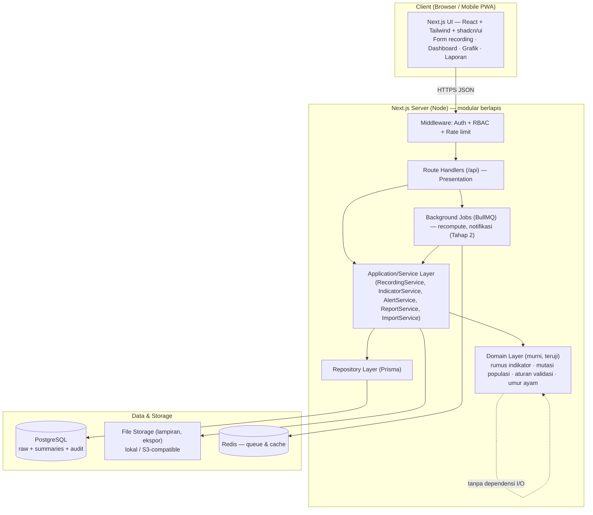
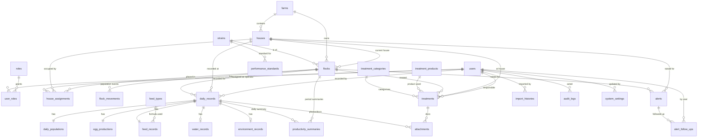

# BrahmaFarm — Sistem Recording Produksi Ayam Petelur Multi-Kandang

**Dokumen Desain Sistem (Bagian 1–7)**
Versi 1.0 · 23 Agustus 2026 · Stack: Next.js (App Router) + TypeScript + Prisma + PostgreSQL + Tailwind + Recharts

> Dokumen ini adalah blueprint yang perlu **Anda review dan setujui** sebelum implementasi kode MVP dimulai. Bagian yang memerlukan konfirmasi Anda ditandai dengan **⚠️ PERLU KONFIRMASI**. Bahasa antarmuka & dokumentasi: Indonesia. Nama tabel/kolom/class/function/endpoint: Inggris (konsisten).

---

## Daftar Isi

1. [Analisis Kebutuhan](#bagian-1--analisis-kebutuhan)
2. [Arsitektur Sistem](#bagian-2--arsitektur-sistem)
3. [Alur Bisnis](#bagian-3--alur-bisnis)
4. [Desain Database](#bagian-4--desain-database)
5. [Rumus & Logika Perhitungan](#bagian-5--rumus--logika-perhitungan)
6. [Desain API](#bagian-6--desain-api)
7. [Desain Antarmuka](#bagian-7--desain-antarmuka)

---

# Bagian 1 — Analisis Kebutuhan

## 1.1 Aktor Sistem

| Aktor | Deskripsi | Akses Inti |
|---|---|---|
| **Super Admin** | Pemilik/pengelola sistem tingkat tertinggi. | Kelola user, farm, house, master data, rumus indikator, target, hak akses; lihat semua laporan; buka & koreksi data terkunci. |
| **Admin Peternakan** (Farm Admin) | Pengelola operasional satu atau beberapa peternakan. | Kelola flock, input & koreksi recording harian, catat perlakuan, lihat dashboard & laporan, ekspor data. Terikat ke farm tertentu. |
| **Petugas Kandang** (House Operator) | Pekerja lapangan penanggung jawab kandang tertentu. | Input recording untuk kandang yang ditugaskan, lihat riwayat input kandangnya. Tidak bisa hapus permanen atau ubah setelan sistem. |
| **Sistem (aktor non-manusia)** | Proses otomatis. | Hitung umur ayam, hitung indikator, propagasi populasi antar-hari, generate peringatan rule-based, jalankan job agregasi. |

Model akses: **RBAC** dengan cakupan data (data scoping). Peran menentukan *aksi apa* yang boleh; penugasan farm/house menentukan *data mana* yang terlihat. Contoh: Petugas Kandang punya peran `HOUSE_OPERATOR` **dan** daftar `house_assignments` yang membatasi kandang miliknya.

## 1.2 Kebutuhan Fungsional (FR)

**Manajemen entitas**
- FR-01 Kelola peternakan (CRUD + nonaktif/soft delete).
- FR-02 Kelola kandang: kapasitas, jenis, lokasi, penanggung jawab, status (kosong/aktif/sanitasi/nonaktif).
- FR-03 Kelola flock dengan seluruh atribut biologis & operasional; satu kandang dapat dipakai banyak flock lintas waktu tanpa kehilangan histori.
- FR-04 Kelola user, peran, dan penugasan farm/house.
- FR-05 Kelola master data: strain, feed types, treatment categories, treatment products, performance standards, system settings.

**Recording & perhitungan**
- FR-06 Input recording harian per (house, flock, tanggal) — satu recording utama per kombinasi.
- FR-07 Hitung umur ayam otomatis (hari, minggu, "mgg+hari") dari tanggal menetas ke tanggal recording.
- FR-08 Propagasi populasi: populasi akhir hari N = populasi awal hari N+1.
- FR-09 Hitung indikator otomatis: HDP, HHP, egg mass, konsumsi pakan/ekor, FCR, berat telur rata-rata, mortalitas harian/kumulatif, deplesi, % telur retak/kotor.
- FR-10 Agregasi harian → mingguan → bulanan → kumulatif per flock/house.
- FR-11 Input massal beberapa kandang dalam satu tabel; simpan-draft; "simpan & lanjut kandang berikutnya".
- FR-12 Nilai bawaan (default) dari recording hari sebelumnya.

**Perlakuan, target, peringatan**
- FR-13 Catat perlakuan multi-kategori (vaksinasi, obat, vitamin, additive, perubahan pakan/cahaya/suhu, sanitasi, biosekuriti, seleksi, dll) dengan withdrawal period.
- FR-14 Tandai perlakuan pada grafik performa (deskriptif, bukan kausal).
- FR-15 Master performance standard per strain × umur (minggu); impor CSV/Excel.
- FR-16 Bandingkan aktual vs target: selisih absolut & %, status normal/waspada/kritis (ambang dapat diatur admin).
- FR-17 Peringatan dini rule-based (HDP turun, FCR naik, pakan/air abnormal, mortalitas naik, berat telur turun, telur abnormal naik, data belum diinput, populasi tak konsisten, perlakuan lewat jadwal, withdrawal belum selesai) dengan status Info/Waspada/Kritis/Ditindaklanjuti/Selesai.

**Laporan & data**
- FR-18 Laporan harian, mingguan, bulanan, per flock, per house, antar-house, riwayat perlakuan, mortalitas/afkir, konsumsi & biaya pakan, aktual vs target, data belum lengkap.
- FR-19 Ekspor Excel, CSV, PDF (format cetak lengkap dengan identitas, ringkasan, tabel, grafik, catatan, petugas, waktu).
- FR-20 Impor massal (house, flock, recording lama, standar, perlakuan) dengan template, validasi, pratinjau, penandaan error, cegah duplikasi, ringkasan, riwayat impor.

**Integritas & keamanan**
- FR-21 Audit trail untuk semua koreksi data historis (nilai lama, baru, user, waktu, alasan).
- FR-22 Verifikasi & penguncian data per periode; hanya Super Admin dapat membuka kunci.
- FR-23 Soft delete untuk data penting; data produksi historis tak terhapus permanen via UI biasa.
- FR-24 RBAC menegakkan setiap aksi & cakupan data.

## 1.3 Kebutuhan Nonfungsional (NFR)

| Kode | Kategori | Target |
|---|---|---|
| NFR-01 | Kegunaan | Form recording satu halaman, navigasi keyboard, responsif HP & desktop. Input 1 kandang < 60 detik oleh petugas terlatih. |
| NFR-02 | Kinerja | Dashboard & query laporan < 2 dtk untuk ≤ 50 kandang × 500 hari data (via ringkasan pra-hitung + index). |
| NFR-03 | Keandalan | Perhitungan indikator deterministik & idempotent; recompute aman diulang. |
| NFR-04 | Keamanan | Password hashing (argon2/bcrypt), JWT access+refresh, RBAC, rate limit, proteksi SQLi (ORM parametrik), validasi ganda FE+BE, sanitasi upload. |
| NFR-05 | Auditabilitas | Semua perubahan data historis tercatat; data terverifikasi terkunci. |
| NFR-06 | Skalabilitas | Arsitektur modular; perhitungan di service layer, dapat dipindah ke background job. |
| NFR-07 | Portabilitas | Deploy via Docker Compose; konfigurasi via environment variable. |
| NFR-08 | Presisi | Simpan angka mentah presisi penuh (DECIMAL); pembulatan hanya untuk tampilan; toleransi pembulatan konsisten. |
| NFR-09 | Ketersediaan | Backup DB terjadwal; migration terversion. |
| NFR-10 | Ekstensibilitas | Rumus & ambang peringatan configurable; siap tambah anomaly detection (ML) di tahap lanjut. |

## 1.4 Asumsi

1. Satu recording utama per (flock, tanggal). Sub-data (populasi, telur, pakan, air, lingkungan) melekat pada recording tersebut.
2. Satu flock menempati tepat satu kandang pada satu waktu; satu kandang boleh menampung **beberapa flock aktif** sekaligus dengan umur berbeda (mis. kandang A berisi flock A1 dan A2). Recording, populasi, dan indikator selalu dihitung per flock. Kandang menjadi `sanitasi` setelah flock aktif terakhir di dalamnya `selesai`/`afkir`. Histori assignment disimpan di `house_assignments`.
3. Tanggal menetas diketahui; umur dihitung dari sana. Jika hanya umur-saat-masuk yang diketahui, tanggal menetas diturunkan mundur.
4. Berat telur diinput dalam **kg** (berat total), telur dalam **butir** — konsisten dengan buku recording lapangan.
5. Konsumsi air & sebagian data lingkungan bersifat opsional (nullable).
6. Mata uang default IDR; harga pakan per kg.
7. Zona waktu operasional: Asia/Jakarta (WIB). Tanggal recording adalah tanggal kalender lokal.
8. Volume: puluhan kandang, ratusan–ribuan hari recording per flock — cocok untuk PostgreSQL tunggal + ringkasan.

## 1.5 Istilah yang Perlu Dikonfirmasi ⚠️ PERLU KONFIRMASI

Ini titik paling rawan salah tafsir. Mohon konfirmasi:

**a. HD / HDP / HHP.** Di lapangan istilah sering dicampur. Definisi yang saya pakai:
- **HDP (Hen-Day Production)** = telur hari ini ÷ **populasi hidup** hari itu × 100. Mengukur produktivitas ayam yang *masih hidup*.
- **HHP (Hen-Housed Production)** = telur hari ini ÷ **populasi awal flock (saat housing)** × 100. Memperhitungkan kematian; selalu ≤ HDP.
- **"HD"** yang sering diucapkan biasanya = HDP. Namun sistem menyediakan **setting istilah & rumus** agar admin bisa menyesuaikan.
- **Populasi untuk HDP** — **KEPUTUSAN: `OPENING` (populasi awal hari itu).** Opsi lain (rata-rata, akhir) tetap tersedia & **configurable** di `system_settings` (`hdp_population_basis`), tetapi default sistem = OPENING sesuai keputusan Anda.

**b. Egg mass & konsumsi pakan** dihitung per ekor per hari memakai **populasi hidup** — konsisten dengan basis HDP yang Anda pilih (default: rata-rata).

**c. FCR** — berbasis **egg mass** (kg pakan ÷ kg massa telur), sesuai spesifikasi. Bukan FCR berbasis pertambahan bobot badan.

**d. Deplesi vs Mortalitas kumulatif** — Deplesi = (mati + afkir) ÷ populasi awal flock. Mortalitas kumulatif = mati saja ÷ populasi awal flock. Keduanya disediakan terpisah.

**e. "Telur layak jual"** — apakah = telur utuh, atau utuh + kotor (yang masih bisa dijual setelah dibersihkan)? Default saya: **total telur** untuk HDP = semua butir yang keluar (utuh+retak+pecah+kotor+abnormal), karena HDP mengukur *produksi biologis*, bukan kelayakan jual. Telur layak jual dilaporkan terpisah. Mohon dikonfirmasi.

## 1.6 Risiko Kesalahan Data & Mitigasi

| Risiko | Dampak | Mitigasi |
|---|---|---|
| Salah input populasi awal | Semua % indikator salah berantai | Auto-propagasi dari hari sebelumnya + validasi mutasi populasi + peringatan lompatan tak wajar |
| HDP > 100% | Data tak masuk akal | Validasi soft-warning; boleh disimpan oleh admin dengan alasan koreksi (tercatat di audit) |
| FCR dibagi massa telur 0 | Error/Infinity | Tampilkan "belum dapat dihitung", jangan hitung |
| Duplikasi recording | Indikator ganda | Unique constraint (flock_id, record_date) + cek duplikasi saat impor |
| Koreksi diam-diam data historis | Kehilangan jejak | Audit trail wajib (old/new/user/time/reason) + penguncian periode |
| Campur aduk aktual vs target vs standar strain | Salah interpretasi | Tabel terpisah: `daily_records` (aktual), `performance_standards` (standar strain), target flock (turunan/override) |
| Salah satuan (butir vs kg vs gram) | Indikator ×1000 meleset | Satuan tetap di skema + label jelas di form + validasi rentang wajar |
| Interpretasi kausal perubahan pasca-perlakuan | Kesimpulan keliru | Marker perlakuan diberi disclaimer "deskriptif, bukan sebab-akibat" di UI & laporan |
| Zona waktu | Tanggal recording geser | Simpan `record_date` sebagai DATE lokal WIB; timestamp sistem UTC |

---

# Bagian 2 — Arsitektur Sistem

## 2.1 Pilihan Teknologi

| Lapisan | Teknologi | Versi target |
|---|---|---|
| Framework | **Next.js 15 (App Router)** | fullstack: UI + Route Handlers (API) dalam satu proyek |
| Bahasa | **TypeScript** (strict) | end-to-end type safety FE↔BE |
| Styling/UI | **Tailwind CSS** + **shadcn/ui** (Radix) | komponen konsisten & aksesibel |
| ORM | **Prisma** | schema-first, migration, type-safe query |
| Database | **PostgreSQL 16** | relasional, DECIMAL presisi, constraint kuat, window functions untuk agregasi |
| Auth | **Auth.js (NextAuth) + JWT** (access + refresh) atau session terenkripsi | RBAC di middleware & server |
| Validasi | **Zod** (dipakai bersama FE & BE) | satu sumber skema validasi |
| State server | **TanStack Query** | caching & sinkronisasi data client |
| Grafik | **Recharts** | HDP/FCR/egg mass per umur, marker perlakuan |
| Tabel | **TanStack Table** | riwayat recording, input massal |
| Ekspor Excel | **ExcelJS** | template & ekspor berwarna |
| Ekspor PDF | **@react-pdf/renderer** atau Playwright→PDF | laporan cetak dengan grafik |
| Impor | **SheetJS (xlsx)** + Zod | parsing + validasi baris |
| Background job | **BullMQ + Redis** (opsional, tahap 2) | recompute massal & notifikasi |
| Test | **Vitest** (unit), **Supertest/Playwright** (integrasi & E2E) | rumus, API, alur input |
| Deploy | **Docker Compose** (web + postgres + redis) | env variable, reprodusibel |

## 2.2 Alasan Pemilihan

**Kenapa Next.js full-stack (bukan Laravel/NestJS/FastAPI terpisah)?**
Untuk tim kecil peternakan, satu codebase satu bahasa (TypeScript) menekan biaya pemeliharaan: model Zod & tipe dipakai bersama frontend dan backend, tak ada drift kontrak API. Next.js memberi SSR untuk halaman berat (dashboard/laporan) sekaligus form interaktif responsif untuk HP — persis kebutuhan petugas kandang di lapangan. PWA/offline (tahap 2) natural di ekosistem ini. Deploy cukup satu container web + Postgres.

**Trade-off yang diterima:** Next.js kurang "opinionated" untuk domain layer dibanding NestJS. Dimitigasi dengan **struktur folder berlapis eksplisit** (`domain/`, `services/`, `repositories/`) sehingga rumus & aturan bisnis terisolasi dan bisa diuji tanpa HTTP/DB.

**Kenapa PostgreSQL:** DECIMAL presisi untuk berat/persentase (hindari float error), constraint & unique kuat untuk integritas recording, window function untuk agregasi mingguan/bulanan/kumulatif efisien, dukungan JSONB untuk lampiran/metadata fleksibel.

**Kenapa Prisma:** migration terversion, query parametrik (anti-SQLi), tipe otomatis. Untuk agregasi berat, kita tetap bisa `queryRaw` SQL yang dioptimasi.

## 2.3 Diagram Arsitektur



Prinsip: **Domain Layer tidak mengimpor apa pun dari Prisma/HTTP** — rumus produktivitas diuji sebagai fungsi murni (input angka → output angka). Service layer mengorkestrasi domain + repository dalam transaksi. Controller (Route Handler) hanya parsing/otorisasi/serialisasi.

## 2.4 Struktur Folder Proyek

```
BrahmaFarm/
├─ docker-compose.yml
├─ Dockerfile
├─ .env.example
├─ package.json
├─ tsconfig.json
├─ next.config.ts
├─ tailwind.config.ts
├─ vitest.config.ts
├─ prisma/
│  ├─ schema.prisma
│  ├─ migrations/
│  └─ seed.ts
├─ src/
│  ├─ app/                          # Presentation (Next.js App Router)
│  │  ├─ (auth)/login/page.tsx
│  │  ├─ (dashboard)/
│  │  │  ├─ layout.tsx
│  │  │  ├─ dashboard/page.tsx
│  │  │  ├─ farms/…  houses/…  flocks/…
│  │  │  ├─ recording/            # input harian & massal
│  │  │  ├─ treatments/…  standards/…  alerts/…
│  │  │  ├─ reports/…  imports/…  users/…  settings/…  audit/…
│  │  └─ api/                      # Route Handlers (REST)
│  │     ├─ auth/[...nextauth]/route.ts
│  │     ├─ farms/route.ts        houses/route.ts  flocks/route.ts
│  │     ├─ recordings/route.ts   recordings/[id]/route.ts
│  │     ├─ indicators/…  treatments/…  standards/…
│  │     ├─ alerts/…  reports/…  imports/…  audit/…
│  ├─ domain/                       # Domain Layer (MURNI, teruji)
│  │  ├─ indicators/
│  │  │  ├─ formulas.ts            # HDP, HHP, eggMass, FCR, dst.
│  │  │  ├─ population.ts          # mutasi & propagasi populasi
│  │  │  ├─ age.ts                 # umur ayam (hari/minggu/mgg+hari)
│  │  │  └─ rounding.ts            # kebijakan pembulatan
│  │  ├─ alerts/rules.ts           # rule-based thresholds
│  │  └─ validation/               # aturan bisnis (bukan skema HTTP)
│  ├─ services/                     # Application/Service Layer
│  │  ├─ recording.service.ts  indicator.service.ts
│  │  ├─ alert.service.ts  report.service.ts  import.service.ts
│  │  └─ audit.service.ts  flock.service.ts
│  ├─ repositories/                 # Data Access (Prisma)
│  │  └─ *.repository.ts
│  ├─ lib/
│  │  ├─ db.ts (Prisma client)  auth.ts  rbac.ts
│  │  ├─ zod/                      # skema Zod (dipakai FE+BE)
│  │  ├─ rate-limit.ts  errors.ts  logger.ts
│  ├─ components/                   # UI reusable (form, charts, tables)
│  └─ types/
└─ tests/
   ├─ unit/ (formulas, population, validation)
   ├─ integration/ (api, auth, import, dedup)
   └─ e2e/ (alur input harian)
```

Pemetaan ke arsitektur berlapis yang diminta: **Presentation** = `app/` + `components/`; **Application/Service** = `services/`; **Domain** = `domain/`; **Data Access** = `repositories/` + Prisma; **Database** = PostgreSQL; **File storage** = `lib` + FS/S3; **Reporting** = `services/report.service.ts` + ExcelJS/PDF; **Background job** = BullMQ (tahap 2).

---

# Bagian 3 — Alur Bisnis

## 3.1 Registrasi Kandang & Flock

```mermaid
sequenceDiagram
  actor SA as Super Admin
  actor FA as Admin Peternakan
  participant S as Sistem
  SA->>S: Buat farm + akun user (peran & penugasan)
  FA->>S: Buat master house (kapasitas, jenis, lokasi, PJ)
  Note over S: Status house = KOSONG
  FA->>S: Buat flock (strain, tgl menetas, tgl masuk, populasi awal, target)
  S->>S: Validasi: tgl masuk ≥ tgl menetas; kandang tak punya flock AKTIF lain
  S->>S: Hitung umur saat masuk; buat house_assignment (start_date)
  S-->>FA: Flock status PERSIAPAN/AKTIF; house status AKTIF
```

Aturan kunci: mengaktifkan flock baru di kandang yang masih punya flock `aktif` **ditolak** — flock lama harus `selesai`/`afkir` dulu (assignment lama diberi `end_date`). Ini menjaga histori (Batasan: "jangan hapus riwayat saat flock berpindah/selesai").

## 3.2 Recording Harian

```mermaid
sequenceDiagram
  actor P as Petugas Kandang
  participant S as Sistem
  P->>S: Pilih tanggal + kandang
  S->>S: Cari flock AKTIF di kandang tsb
  S->>S: Ambil populasi akhir hari sebelumnya → populasi awal hari ini
  S->>S: Hitung umur ayam pada tanggal recording
  S-->>P: Tampilkan form terisi default (populasi awal, umur, sisa pakan kemarin)
  P->>S: Isi mortalitas, afkir, transfer, telur (per kategori), pakan, air, lingkungan, catatan
  S->>S: Hitung langsung (preview) populasi akhir + indikator sebelum simpan
  P->>S: Simpan (atau Simpan Draft / Simpan & lanjut kandang berikutnya)
  S->>S: Validasi (Bagian aturan) dalam TRANSAKSI
  alt Lolos
    S->>S: Simpan raw + hitung & simpan summary + evaluasi peringatan
    S-->>P: Sukses; tandai kandang "sudah diinput"
  else Nilai tak wajar
    S-->>P: Soft-warning; admin boleh simpan dgn alasan (audit)
  else Gagal keras (mis. duplikat/negatif)
    S-->>P: Tolak + pesan jelas
  end
```

## 3.3 Pencatatan Perlakuan

Admin/Petugas memilih farm→house→flock, kategori perlakuan, produk, dosis+satuan, cara pemberian, tanggal mulai–selesai, PJ, biaya, dan **withdrawal period** bila relevan. Sistem menghitung `withdrawal_until = end_date + withdrawal_days` dan menyalakan peringatan aktif selama periode itu. Perlakuan tampil sebagai **marker** pada grafik performa (dengan disclaimer non-kausal).

## 3.4 Verifikasi & Koreksi

```mermaid
flowchart LR
  A[Recording tersimpan] --> B{Butuh koreksi?}
  B -- Ya --> C[Edit oleh Admin]
  C --> D[Audit log: old,new,user,time,reason]
  D --> E[Recompute summary hari itu + hari sesudahnya\n(populasi berantai)]
  B -- Tidak --> F[Verifikasi periode]
  F --> G[Kunci data periode]
  G --> H{Perlu ubah data terkunci?}
  H -- Ya --> I[Hanya Super Admin buka kunci → koreksi → audit → kunci ulang]
  H -- Tidak --> J[Selesai]
```

Koreksi data yang mengubah populasi memicu **recompute berantai**: karena populasi akhir hari N memengaruhi populasi awal hari N+1, service menghitung ulang ringkasan dari tanggal koreksi sampai recording terakhir flock tsb.

## 3.5 Peringatan Dini

Saat recording disimpan (atau via job harian), `AlertService` menjalankan aturan (`domain/alerts/rules.ts`) terhadap nilai aktual, target strain×umur, dan riwayat: mis. HDP turun > X poin vs 7-hari rata-rata, FCR > ambang, mortalitas harian > ambang, data belum diinput per kandang jam tertentu, populasi tak konsisten, withdrawal belum selesai. Peringatan dibuat dengan tingkat Info/Waspada/Kritis dan bisa ditindaklanjuti (status → Ditindaklanjuti → Selesai) dengan catatan. Desain aturan dipisah agar tahap lanjut bisa menambah **anomaly detection ML** tanpa mengubah pemicu.

## 3.6 Laporan

Admin memilih jenis laporan + filter (rentang tanggal, farm, house, flock, strain, umur, fase). `ReportService` membaca ringkasan (atau menghitung on-demand jika ringkasan belum ada/kotor), menyusun tabel + grafik + marker perlakuan, lalu mengekspor ke Excel/CSV/PDF. Laporan PDF memuat identitas peternakan, periode, identitas kandang/flock, ringkasan indikator, tabel recording, grafik, catatan perlakuan, nama petugas, dan waktu pembuatan.

---

# Bagian 4 — Desain Database

Database relasional ternormalisasi (≈3NF). Data mentah recording dipecah ke tabel anak 1-1 (`daily_populations`, `egg_productions`, `feed_records`, `water_records`, `environment_records`) yang semuanya melekat ke `daily_records` — memudahkan validasi per-domain & nullable yang bersih. Ringkasan indikator disimpan di `productivity_summaries` (dapat dihitung ulang). Semua data penting memakai **soft delete** (`deleted_at`).

## 4.1 Entity Relationship Diagram (Mermaid)



## 4.2 Penjelasan Tabel

Konvensi umum: PK `id BIGINT GENERATED ALWAYS AS IDENTITY`; timestamp `created_at`, `updated_at TIMESTAMPTZ DEFAULT now()`; soft delete `deleted_at TIMESTAMPTZ NULL`. Uang `NUMERIC(14,2)`, persentase `NUMERIC(7,3)`, berat kg `NUMERIC(12,3)`.

**users** — akun pengguna. Kolom: `id, email (unique), full_name, password_hash, phone, is_active, last_login_at, created_at, updated_at, deleted_at`. Index: `email`.

**roles** — peran RBAC. `id, code (unique: SUPER_ADMIN|FARM_ADMIN|HOUSE_OPERATOR), name, description`. Seed tetap.

**user_roles** — M:N user↔role. `id, user_id FK→users, role_id FK→roles, farm_id FK→farms NULL (cakupan peran, mis. Farm Admin utk farm tertentu)`. Unique `(user_id, role_id, farm_id)`. ON DELETE CASCADE dari user (hard—join table).

**farms** — peternakan. `id, code (unique), name, address, city, owner_name, timezone (default 'Asia/Jakarta'), currency (default 'IDR'), is_active, +audit/soft`. 

**houses** — kandang. `id, farm_id FK, code, name, house_type (BATTERY|POSTAL|CAGE_FREE|OTHER), capacity INT, location, responsible_user_id FK→users NULL, status (EMPTY|ACTIVE|SANITATION|INACTIVE) default EMPTY, +audit/soft`. Unique `(farm_id, code)`. Index `farm_id, status`.

**house_assignments** — histori penempatan flock di kandang (menjaga jejak lintas siklus). `id, house_id FK, flock_id FK, start_date DATE, end_date DATE NULL, operator_user_id FK→users NULL, note`. Index `(house_id, start_date)`, `(flock_id)`. Constraint: tak boleh dua assignment aktif (`end_date IS NULL`) di house yang sama — ditegakkan lewat partial unique index.

**strains** — galur ayam. `id, code (unique), name, breeder, description, +soft`. Contoh: ISA Brown, Lohmann Brown, Hy-Line.

**flocks** — kelompok ayam. `id, farm_id FK, house_id FK (kandang saat ini), code, strain_id FK, source_supplier, hatch_date DATE, entry_date DATE, entry_age_days INT (turunan/verifikasi), initial_population INT, rearing_type (PULLET_REARED|DOC), production_phase (PRE_LAY|EARLY_LAY|PEAK|LATE_LAY|SPENT), target_production_note, planned_cull_date DATE NULL, actual_cull_date DATE NULL, status (PREPARATION|ACTIVE|COMPLETED|CULLED), notes, +audit/soft`. Unique `(farm_id, code)`. Index `house_id, status, strain_id`. Umur **tidak** disimpan sebagai kolom harian—dihitung dari `hatch_date`.

**flock_movements** — event mutasi populasi non-harian (transfer antar-kandang, seleksi massal, koreksi populasi awal). `id, flock_id FK, movement_date DATE, movement_type (IN|OUT|CULL|MORTALITY_ADJ|CORRECTION), quantity INT, from_house_id NULL, to_house_id NULL, reason, created_by FK`. Sumber kebenaran untuk transfer lintas kandang; recording harian tetap mencatat mutasi harian rutin.

**daily_records** — recording utama per (flock, tanggal). `id, farm_id FK, house_id FK, flock_id FK, record_date DATE, age_days INT (snapshot, diturunkan), recorded_by FK→users, recorded_at TIMESTAMPTZ, status (DRAFT|SUBMITTED|VERIFIED|LOCKED), verified_by FK NULL, verified_at NULL, general_note, +audit/soft`. **Unique `(flock_id, record_date)` (WHERE deleted_at IS NULL)** — satu recording utama per hari. Index `(house_id, record_date)`, `(farm_id, record_date)`, `status`.

**daily_populations** — mutasi populasi harian (1-1 daily_records). `id, daily_record_id FK unique, opening_population INT, mortality INT, culling INT, transfer_in INT, transfer_out INT, closing_population INT`. Check: semua ≥ 0; `mortality+culling ≤ opening_population+transfer_in`; `closing = opening - mortality - culling + transfer_in - transfer_out`.

**egg_productions** — produksi telur (1-1). `id, daily_record_id FK unique, whole_eggs INT, cracked_eggs INT, broken_eggs INT, dirty_eggs INT, abnormal_eggs INT, total_eggs INT, total_weight_kg NUMERIC(12,3), sample_weight_g NUMERIC(8,2) NULL, trays INT NULL, grade_breakdown JSONB NULL`. Check: tiap kategori ≥ 0; `total_eggs = whole+cracked+broken+dirty+abnormal`; berat ≥ 0.

**feed_records** — pakan (1-1). `id, daily_record_id FK unique, feed_type_id FK→feed_types NULL, opening_stock_kg, feed_in_kg, feed_given_kg, feed_leftover_kg, feed_consumed_kg, batch_code, price_per_kg NUMERIC(12,2) NULL`. Check ≥ 0; `feed_consumed_kg = feed_given_kg - feed_leftover_kg` (bila diisi).

**water_records** — air (1-1 opsional). `id, daily_record_id FK unique, water_consumption_l NUMERIC(12,2) NULL, note`.

**environment_records** — lingkungan (1-1 opsional). `id, daily_record_id FK unique, temp_min, temp_max, temp_avg NUMERIC(6,2), humidity_pct NUMERIC(6,2), thi NUMERIC(6,2) NULL, light_hours NUMERIC(5,2), ventilation_note, weather_note`.

**feed_types** — master formula pakan. `id, farm_id FK NULL (global bila null), code, name, phase, default_price_per_kg, description, +soft`. Unique `(farm_id, code)`.

**treatment_categories** — kategori perlakuan (seed: VACCINATION, MEDICATION, VITAMIN, PROBIOTIC, FEED_ADDITIVE, FEED_FORMULA_CHANGE, NUTRITION_EXPERIMENT, LIGHTING_CHANGE, TEMPERATURE_MGMT, SANITATION, BIOSECURITY, SELECTION_CULL, OTHER). `id, code unique, name, requires_withdrawal BOOL`.

**treatment_products** — master produk. `id, category_id FK, code, name, default_dose, default_dose_unit, default_route, default_withdrawal_days INT NULL, +soft`. Unique `(category_id, code)`.

**treatments** — catatan perlakuan. `id, farm_id FK, house_id FK, flock_id FK, category_id FK, product_id FK NULL, name, purpose, dose NUMERIC(12,3) NULL, dose_unit, route, duration_days INT NULL, start_date DATE, end_date DATE NULL, withdrawal_days INT NULL, withdrawal_until DATE NULL (turunan), responsible_user_id FK, cost NUMERIC(14,2) NULL, observation_note, status (PLANNED|ONGOING|COMPLETED|CANCELLED), +audit/soft`. Index `(flock_id, start_date)`, `withdrawal_until`.

**performance_standards** — standar strain (bukan aktual!). `id, strain_id FK, age_week INT, hdp_target NUMERIC(7,3), feed_intake_target_g NUMERIC(8,2), egg_weight_target_g NUMERIC(7,2), egg_mass_target_g NUMERIC(8,2), fcr_target NUMERIC(6,3), body_weight_target_g NUMERIC(8,1) NULL, max_mortality_pct NUMERIC(6,3), source_label`. Unique `(strain_id, age_week)`. Impor via CSV/Excel.

**productivity_summaries** — ringkasan indikator (turunan, recompute-able). `id, flock_id FK, house_id FK, period_type (DAILY|WEEKLY|MONTHLY|CYCLE), period_key (mis. '2026-08-23' | '2026-W34' | '2026-08' | 'CYCLE'), period_start DATE, period_end DATE, age_days INT NULL, age_week INT NULL, avg_population NUMERIC(12,2), total_eggs INT, total_egg_weight_kg NUMERIC(14,3), hdp_pct, hhp_pct, egg_mass_g, feed_intake_g, fcr, avg_egg_weight_g, mortality_pct, cum_mortality_pct, depletion_pct, cracked_pct, dirty_pct, feed_consumed_kg, feed_cost, is_stale BOOL default false, computed_at`. Unique `(flock_id, period_type, period_key)`. Index `(flock_id, period_type, period_start)`.

**alerts** — peringatan. `id, farm_id FK, house_id FK NULL, flock_id FK NULL, alert_type (HDP_DROP|FCR_HIGH|FEED_ABNORMAL|WATER_ABNORMAL|MORTALITY_HIGH|EGG_WEIGHT_DROP|ABNORMAL_EGG_HIGH|MISSING_RECORD|POPULATION_INCONSISTENT|TREATMENT_OVERDUE|WITHDRAWAL_ACTIVE), severity (INFO|WARNING|CRITICAL), status (OPEN|ACKNOWLEDGED|RESOLVED), record_date DATE, message, context JSONB (nilai aktual/target/ambang), created_at`. Index `(farm_id, status, severity)`, `record_date`.

**alert_follow_ups** — tindak lanjut. `id, alert_id FK, user_id FK, action_note, new_status, treatment_id FK NULL, created_at`.

**attachments** — lampiran polymorphic. `id, owner_type (DAILY_RECORD|TREATMENT), owner_id BIGINT, file_name, mime_type, size_bytes, storage_path, uploaded_by FK, created_at`. Index `(owner_type, owner_id)`. Validasi tipe & ukuran di aplikasi.

**import_histories** — riwayat impor. `id, user_id FK, import_type (HOUSE|FLOCK|RECORDING|STANDARD|TREATMENT), file_name, total_rows, success_rows, failed_rows, status (PENDING|PROCESSING|DONE|FAILED), error_report_path NULL, created_at, finished_at`.

**audit_logs** — jejak perubahan. `id, user_id FK, entity_type, entity_id BIGINT, action (CREATE|UPDATE|DELETE|LOCK|UNLOCK|VERIFY), old_values JSONB NULL, new_values JSONB NULL, reason TEXT NULL, ip_address, created_at`. Index `(entity_type, entity_id)`, `user_id, created_at`.

**system_settings** — konfigurasi (rumus, ambang, istilah). `id, farm_id FK NULL (null=global), key (unique per farm), value JSONB, description, updated_by FK, updated_at`. Contoh key: `hdp_population_basis` (AVERAGE|OPENING|CLOSING), `alert_thresholds`, `hdp_term_label`, `rounding_display`.

## 4.3 Relasi & Aturan Hapus/Perbarui

- **Soft delete** untuk semua entitas domain (`deleted_at`); data produksi historis (recording/summary/movement) **tidak** dihapus via UI biasa. Query default menambahkan `WHERE deleted_at IS NULL`.
- Anak 1-1 recording (`daily_populations` dst.) → **ON DELETE CASCADE** terhadap `daily_records` (jika record induk benar-benar dihapus di level DB/admin), namun secara aplikatif memakai soft delete di induk.
- `house_assignments`, `flock_movements` → **RESTRICT** hapus flock/house yang punya histori (histori wajib dipertahankan; gunakan nonaktif/soft).
- `user_roles` → CASCADE dari `users`/`roles` (join table murni).
- Perubahan `daily_records` yang memengaruhi populasi → memicu recompute berantai `productivity_summaries` (flag `is_stale` lalu recompute).

## 4.4 Constraint & Index Ringkas

Constraint kritis: unique `daily_records(flock_id, record_date) WHERE deleted_at IS NULL`; partial unique `house_assignments(house_id) WHERE end_date IS NULL`; unique `performance_standards(strain_id, age_week)`; unique `productivity_summaries(flock_id, period_type, period_key)`; seluruh CHECK non-negatif & identitas populasi/telur (lihat 4.2). Index dibuat pada seluruh FK dan kolom filter dashboard (`record_date`, `status`, `severity`).

## 4.5 Strategi Menjaga Histori Flock & Kandang

1. Kandang adalah wadah tetap; **flock** adalah siklus. Relasi historis kandang↔flock disimpan di `house_assignments` dengan `start_date`/`end_date`.
2. Saat flock `selesai`/`afkir`: set `actual_cull_date`, `status=COMPLETED/CULLED`, isi `end_date` assignment, set `house.status=EMPTY/SANITATION`. **Tidak ada** data recording/summary yang dihapus.
3. Flock baru di kandang sama → assignment baru; data lama tetap dapat dilaporkan (rekap per flock/siklus).
4. Semua koreksi lewat audit trail; penguncian periode mencegah perubahan tak sengaja.

## 4.6 SQL Schema / Migration (PostgreSQL)

> DDL inti berikut adalah sumber kebenaran skema; pada implementasi Prisma (Bagian 8) skema ini direpresentasikan di `schema.prisma` dan menghasilkan migration setara. Kolom audit `created_at/updated_at/deleted_at` disingkat sebagai komentar bila berulang.

```sql
-- ============ ENUMS ============
CREATE TYPE house_status   AS ENUM ('EMPTY','ACTIVE','SANITATION','INACTIVE');
CREATE TYPE house_type     AS ENUM ('BATTERY','POSTAL','CAGE_FREE','OTHER');
CREATE TYPE flock_status   AS ENUM ('PREPARATION','ACTIVE','COMPLETED','CULLED');
CREATE TYPE production_phase AS ENUM ('PRE_LAY','EARLY_LAY','PEAK','LATE_LAY','SPENT');
CREATE TYPE rearing_type   AS ENUM ('PULLET_REARED','DOC');
CREATE TYPE record_status  AS ENUM ('DRAFT','SUBMITTED','VERIFIED','LOCKED');
CREATE TYPE movement_type  AS ENUM ('IN','OUT','CULL','MORTALITY_ADJ','CORRECTION');
CREATE TYPE treatment_status AS ENUM ('PLANNED','ONGOING','COMPLETED','CANCELLED');
CREATE TYPE alert_severity AS ENUM ('INFO','WARNING','CRITICAL');
CREATE TYPE alert_status   AS ENUM ('OPEN','ACKNOWLEDGED','RESOLVED');
CREATE TYPE period_type    AS ENUM ('DAILY','WEEKLY','MONTHLY','CYCLE');
CREATE TYPE import_type    AS ENUM ('HOUSE','FLOCK','RECORDING','STANDARD','TREATMENT');
CREATE TYPE import_status  AS ENUM ('PENDING','PROCESSING','DONE','FAILED');
CREATE TYPE audit_action   AS ENUM ('CREATE','UPDATE','DELETE','LOCK','UNLOCK','VERIFY');

-- ============ AUTH & RBAC ============
CREATE TABLE users (
  id BIGINT GENERATED ALWAYS AS IDENTITY PRIMARY KEY,
  email TEXT NOT NULL UNIQUE,
  full_name TEXT NOT NULL,
  password_hash TEXT NOT NULL,
  phone TEXT,
  is_active BOOLEAN NOT NULL DEFAULT true,
  last_login_at TIMESTAMPTZ,
  created_at TIMESTAMPTZ NOT NULL DEFAULT now(),
  updated_at TIMESTAMPTZ NOT NULL DEFAULT now(),
  deleted_at TIMESTAMPTZ
);
CREATE TABLE roles (
  id BIGINT GENERATED ALWAYS AS IDENTITY PRIMARY KEY,
  code TEXT NOT NULL UNIQUE,   -- SUPER_ADMIN | FARM_ADMIN | HOUSE_OPERATOR
  name TEXT NOT NULL,
  description TEXT
);
CREATE TABLE farms (
  id BIGINT GENERATED ALWAYS AS IDENTITY PRIMARY KEY,
  code TEXT NOT NULL UNIQUE,
  name TEXT NOT NULL,
  address TEXT, city TEXT, owner_name TEXT,
  timezone TEXT NOT NULL DEFAULT 'Asia/Jakarta',
  currency TEXT NOT NULL DEFAULT 'IDR',
  is_active BOOLEAN NOT NULL DEFAULT true,
  created_at TIMESTAMPTZ NOT NULL DEFAULT now(),
  updated_at TIMESTAMPTZ NOT NULL DEFAULT now(),
  deleted_at TIMESTAMPTZ
);
CREATE TABLE user_roles (
  id BIGINT GENERATED ALWAYS AS IDENTITY PRIMARY KEY,
  user_id BIGINT NOT NULL REFERENCES users(id) ON DELETE CASCADE,
  role_id BIGINT NOT NULL REFERENCES roles(id) ON DELETE CASCADE,
  farm_id BIGINT REFERENCES farms(id) ON DELETE CASCADE,
  UNIQUE (user_id, role_id, farm_id)
);

-- ============ MASTER ============
CREATE TABLE strains (
  id BIGINT GENERATED ALWAYS AS IDENTITY PRIMARY KEY,
  code TEXT NOT NULL UNIQUE, name TEXT NOT NULL, breeder TEXT, description TEXT,
  deleted_at TIMESTAMPTZ
);
CREATE TABLE houses (
  id BIGINT GENERATED ALWAYS AS IDENTITY PRIMARY KEY,
  farm_id BIGINT NOT NULL REFERENCES farms(id),
  code TEXT NOT NULL, name TEXT NOT NULL,
  house_type house_type NOT NULL DEFAULT 'BATTERY',
  capacity INT CHECK (capacity IS NULL OR capacity >= 0),
  location TEXT,
  responsible_user_id BIGINT REFERENCES users(id),
  status house_status NOT NULL DEFAULT 'EMPTY',
  created_at TIMESTAMPTZ NOT NULL DEFAULT now(),
  updated_at TIMESTAMPTZ NOT NULL DEFAULT now(),
  deleted_at TIMESTAMPTZ,
  UNIQUE (farm_id, code)
);
CREATE TABLE feed_types (
  id BIGINT GENERATED ALWAYS AS IDENTITY PRIMARY KEY,
  farm_id BIGINT REFERENCES farms(id),
  code TEXT NOT NULL, name TEXT NOT NULL, phase TEXT,
  default_price_per_kg NUMERIC(12,2), description TEXT,
  deleted_at TIMESTAMPTZ,
  UNIQUE (farm_id, code)
);

-- ============ FLOCK ============
CREATE TABLE flocks (
  id BIGINT GENERATED ALWAYS AS IDENTITY PRIMARY KEY,
  farm_id BIGINT NOT NULL REFERENCES farms(id),
  house_id BIGINT NOT NULL REFERENCES houses(id),
  code TEXT NOT NULL,
  strain_id BIGINT NOT NULL REFERENCES strains(id),
  source_supplier TEXT,
  hatch_date DATE NOT NULL,
  entry_date DATE NOT NULL,
  entry_age_days INT,
  initial_population INT NOT NULL CHECK (initial_population >= 0),
  rearing_type rearing_type NOT NULL DEFAULT 'PULLET_REARED',
  production_phase production_phase NOT NULL DEFAULT 'PRE_LAY',
  target_production_note TEXT,
  planned_cull_date DATE, actual_cull_date DATE,
  status flock_status NOT NULL DEFAULT 'PREPARATION',
  notes TEXT,
  created_at TIMESTAMPTZ NOT NULL DEFAULT now(),
  updated_at TIMESTAMPTZ NOT NULL DEFAULT now(),
  deleted_at TIMESTAMPTZ,
  UNIQUE (farm_id, code),
  CHECK (entry_date >= hatch_date)
);
CREATE TABLE house_assignments (
  id BIGINT GENERATED ALWAYS AS IDENTITY PRIMARY KEY,
  house_id BIGINT NOT NULL REFERENCES houses(id),
  flock_id BIGINT NOT NULL REFERENCES flocks(id),
  start_date DATE NOT NULL, end_date DATE,
  operator_user_id BIGINT REFERENCES users(id),
  note TEXT,
  CHECK (end_date IS NULL OR end_date >= start_date)
);
-- satu penempatan terbuka per flock (kandang boleh berisi beberapa flock aktif)
CREATE UNIQUE INDEX uq_open_assignment_per_flock ON house_assignments(flock_id) WHERE end_date IS NULL;

CREATE TABLE flock_movements (
  id BIGINT GENERATED ALWAYS AS IDENTITY PRIMARY KEY,
  flock_id BIGINT NOT NULL REFERENCES flocks(id),
  movement_date DATE NOT NULL,
  movement_type movement_type NOT NULL,
  quantity INT NOT NULL CHECK (quantity >= 0),
  from_house_id BIGINT REFERENCES houses(id),
  to_house_id BIGINT REFERENCES houses(id),
  reason TEXT,
  created_by BIGINT REFERENCES users(id),
  created_at TIMESTAMPTZ NOT NULL DEFAULT now()
);

-- ============ RECORDING (raw) ============
CREATE TABLE daily_records (
  id BIGINT GENERATED ALWAYS AS IDENTITY PRIMARY KEY,
  farm_id BIGINT NOT NULL REFERENCES farms(id),
  house_id BIGINT NOT NULL REFERENCES houses(id),
  flock_id BIGINT NOT NULL REFERENCES flocks(id),
  record_date DATE NOT NULL,
  age_days INT,
  recorded_by BIGINT REFERENCES users(id),
  recorded_at TIMESTAMPTZ NOT NULL DEFAULT now(),
  status record_status NOT NULL DEFAULT 'SUBMITTED',
  verified_by BIGINT REFERENCES users(id),
  verified_at TIMESTAMPTZ,
  general_note TEXT,
  created_at TIMESTAMPTZ NOT NULL DEFAULT now(),
  updated_at TIMESTAMPTZ NOT NULL DEFAULT now(),
  deleted_at TIMESTAMPTZ
);
CREATE UNIQUE INDEX uq_record_per_day ON daily_records(flock_id, record_date) WHERE deleted_at IS NULL;
CREATE INDEX ix_dr_house_date ON daily_records(house_id, record_date);
CREATE INDEX ix_dr_farm_date  ON daily_records(farm_id, record_date);

CREATE TABLE daily_populations (
  id BIGINT GENERATED ALWAYS AS IDENTITY PRIMARY KEY,
  daily_record_id BIGINT NOT NULL UNIQUE REFERENCES daily_records(id) ON DELETE CASCADE,
  opening_population INT NOT NULL CHECK (opening_population >= 0),
  mortality INT NOT NULL DEFAULT 0 CHECK (mortality >= 0),
  culling   INT NOT NULL DEFAULT 0 CHECK (culling  >= 0),
  transfer_in  INT NOT NULL DEFAULT 0 CHECK (transfer_in  >= 0),
  transfer_out INT NOT NULL DEFAULT 0 CHECK (transfer_out >= 0),
  closing_population INT NOT NULL CHECK (closing_population >= 0),
  CHECK (mortality + culling <= opening_population + transfer_in),
  CHECK (closing_population = opening_population - mortality - culling + transfer_in - transfer_out)
);
CREATE TABLE egg_productions (
  id BIGINT GENERATED ALWAYS AS IDENTITY PRIMARY KEY,
  daily_record_id BIGINT NOT NULL UNIQUE REFERENCES daily_records(id) ON DELETE CASCADE,
  whole_eggs INT NOT NULL DEFAULT 0 CHECK (whole_eggs >= 0),
  cracked_eggs INT NOT NULL DEFAULT 0 CHECK (cracked_eggs >= 0),
  broken_eggs INT NOT NULL DEFAULT 0 CHECK (broken_eggs >= 0),
  dirty_eggs INT NOT NULL DEFAULT 0 CHECK (dirty_eggs >= 0),
  abnormal_eggs INT NOT NULL DEFAULT 0 CHECK (abnormal_eggs >= 0),
  total_eggs INT NOT NULL CHECK (total_eggs >= 0),
  total_weight_kg NUMERIC(12,3) NOT NULL DEFAULT 0 CHECK (total_weight_kg >= 0),
  sample_weight_g NUMERIC(8,2), trays INT, grade_breakdown JSONB,
  CHECK (total_eggs = whole_eggs + cracked_eggs + broken_eggs + dirty_eggs + abnormal_eggs)
);
CREATE TABLE feed_records (
  id BIGINT GENERATED ALWAYS AS IDENTITY PRIMARY KEY,
  daily_record_id BIGINT NOT NULL UNIQUE REFERENCES daily_records(id) ON DELETE CASCADE,
  feed_type_id BIGINT REFERENCES feed_types(id),
  opening_stock_kg NUMERIC(12,3) DEFAULT 0 CHECK (opening_stock_kg >= 0),
  feed_in_kg NUMERIC(12,3) DEFAULT 0 CHECK (feed_in_kg >= 0),
  feed_given_kg NUMERIC(12,3) DEFAULT 0 CHECK (feed_given_kg >= 0),
  feed_leftover_kg NUMERIC(12,3) DEFAULT 0 CHECK (feed_leftover_kg >= 0),
  feed_consumed_kg NUMERIC(12,3) NOT NULL DEFAULT 0 CHECK (feed_consumed_kg >= 0),
  batch_code TEXT, price_per_kg NUMERIC(12,2)
);
CREATE TABLE water_records (
  id BIGINT GENERATED ALWAYS AS IDENTITY PRIMARY KEY,
  daily_record_id BIGINT NOT NULL UNIQUE REFERENCES daily_records(id) ON DELETE CASCADE,
  water_consumption_l NUMERIC(12,2) CHECK (water_consumption_l IS NULL OR water_consumption_l >= 0),
  note TEXT
);
CREATE TABLE environment_records (
  id BIGINT GENERATED ALWAYS AS IDENTITY PRIMARY KEY,
  daily_record_id BIGINT NOT NULL UNIQUE REFERENCES daily_records(id) ON DELETE CASCADE,
  temp_min NUMERIC(6,2), temp_max NUMERIC(6,2), temp_avg NUMERIC(6,2),
  humidity_pct NUMERIC(6,2), thi NUMERIC(6,2), light_hours NUMERIC(5,2),
  ventilation_note TEXT, weather_note TEXT
);

-- ============ TREATMENT ============
CREATE TABLE treatment_categories (
  id BIGINT GENERATED ALWAYS AS IDENTITY PRIMARY KEY,
  code TEXT NOT NULL UNIQUE, name TEXT NOT NULL,
  requires_withdrawal BOOLEAN NOT NULL DEFAULT false
);
CREATE TABLE treatment_products (
  id BIGINT GENERATED ALWAYS AS IDENTITY PRIMARY KEY,
  category_id BIGINT NOT NULL REFERENCES treatment_categories(id),
  code TEXT NOT NULL, name TEXT NOT NULL,
  default_dose NUMERIC(12,3), default_dose_unit TEXT, default_route TEXT,
  default_withdrawal_days INT, deleted_at TIMESTAMPTZ,
  UNIQUE (category_id, code)
);
CREATE TABLE treatments (
  id BIGINT GENERATED ALWAYS AS IDENTITY PRIMARY KEY,
  farm_id BIGINT NOT NULL REFERENCES farms(id),
  house_id BIGINT NOT NULL REFERENCES houses(id),
  flock_id BIGINT NOT NULL REFERENCES flocks(id),
  category_id BIGINT NOT NULL REFERENCES treatment_categories(id),
  product_id BIGINT REFERENCES treatment_products(id),
  name TEXT NOT NULL, purpose TEXT,
  dose NUMERIC(12,3), dose_unit TEXT, route TEXT, duration_days INT,
  start_date DATE NOT NULL, end_date DATE,
  withdrawal_days INT, withdrawal_until DATE,
  responsible_user_id BIGINT REFERENCES users(id),
  cost NUMERIC(14,2), observation_note TEXT,
  status treatment_status NOT NULL DEFAULT 'PLANNED',
  created_at TIMESTAMPTZ NOT NULL DEFAULT now(),
  updated_at TIMESTAMPTZ NOT NULL DEFAULT now(),
  deleted_at TIMESTAMPTZ
);
CREATE INDEX ix_treat_flock_date ON treatments(flock_id, start_date);
CREATE INDEX ix_treat_withdrawal ON treatments(withdrawal_until);

-- ============ STANDARD & SUMMARY ============
CREATE TABLE performance_standards (
  id BIGINT GENERATED ALWAYS AS IDENTITY PRIMARY KEY,
  strain_id BIGINT NOT NULL REFERENCES strains(id),
  age_week INT NOT NULL CHECK (age_week >= 0),
  hdp_target NUMERIC(7,3), feed_intake_target_g NUMERIC(8,2),
  egg_weight_target_g NUMERIC(7,2), egg_mass_target_g NUMERIC(8,2),
  fcr_target NUMERIC(6,3), body_weight_target_g NUMERIC(8,1),
  max_mortality_pct NUMERIC(6,3), source_label TEXT,
  UNIQUE (strain_id, age_week)
);
CREATE TABLE productivity_summaries (
  id BIGINT GENERATED ALWAYS AS IDENTITY PRIMARY KEY,
  flock_id BIGINT NOT NULL REFERENCES flocks(id),
  house_id BIGINT NOT NULL REFERENCES houses(id),
  period_type period_type NOT NULL,
  period_key TEXT NOT NULL,
  period_start DATE NOT NULL, period_end DATE NOT NULL,
  age_days INT, age_week INT,
  avg_population NUMERIC(12,2),
  total_eggs INT, total_egg_weight_kg NUMERIC(14,3),
  hdp_pct NUMERIC(7,3), hhp_pct NUMERIC(7,3),
  egg_mass_g NUMERIC(8,3), feed_intake_g NUMERIC(8,2),
  fcr NUMERIC(8,4), avg_egg_weight_g NUMERIC(7,2),
  mortality_pct NUMERIC(7,4), cum_mortality_pct NUMERIC(7,4), depletion_pct NUMERIC(7,4),
  cracked_pct NUMERIC(7,3), dirty_pct NUMERIC(7,3),
  feed_consumed_kg NUMERIC(14,3), feed_cost NUMERIC(16,2),
  is_stale BOOLEAN NOT NULL DEFAULT false,
  computed_at TIMESTAMPTZ NOT NULL DEFAULT now(),
  UNIQUE (flock_id, period_type, period_key)
);
CREATE INDEX ix_summary_flock ON productivity_summaries(flock_id, period_type, period_start);

-- ============ ALERTS / ATTACH / IMPORT / AUDIT / SETTINGS ============
CREATE TABLE alerts (
  id BIGINT GENERATED ALWAYS AS IDENTITY PRIMARY KEY,
  farm_id BIGINT NOT NULL REFERENCES farms(id),
  house_id BIGINT REFERENCES houses(id),
  flock_id BIGINT REFERENCES flocks(id),
  alert_type TEXT NOT NULL,
  severity alert_severity NOT NULL DEFAULT 'INFO',
  status alert_status NOT NULL DEFAULT 'OPEN',
  record_date DATE, message TEXT NOT NULL, context JSONB,
  created_at TIMESTAMPTZ NOT NULL DEFAULT now()
);
CREATE INDEX ix_alert_farm_status ON alerts(farm_id, status, severity);
CREATE TABLE alert_follow_ups (
  id BIGINT GENERATED ALWAYS AS IDENTITY PRIMARY KEY,
  alert_id BIGINT NOT NULL REFERENCES alerts(id) ON DELETE CASCADE,
  user_id BIGINT REFERENCES users(id),
  action_note TEXT, new_status alert_status,
  treatment_id BIGINT REFERENCES treatments(id),
  created_at TIMESTAMPTZ NOT NULL DEFAULT now()
);
CREATE TABLE attachments (
  id BIGINT GENERATED ALWAYS AS IDENTITY PRIMARY KEY,
  owner_type TEXT NOT NULL, owner_id BIGINT NOT NULL,
  file_name TEXT NOT NULL, mime_type TEXT, size_bytes BIGINT,
  storage_path TEXT NOT NULL, uploaded_by BIGINT REFERENCES users(id),
  created_at TIMESTAMPTZ NOT NULL DEFAULT now()
);
CREATE INDEX ix_attach_owner ON attachments(owner_type, owner_id);
CREATE TABLE import_histories (
  id BIGINT GENERATED ALWAYS AS IDENTITY PRIMARY KEY,
  user_id BIGINT REFERENCES users(id),
  import_type import_type NOT NULL, file_name TEXT,
  total_rows INT DEFAULT 0, success_rows INT DEFAULT 0, failed_rows INT DEFAULT 0,
  status import_status NOT NULL DEFAULT 'PENDING',
  error_report_path TEXT, created_at TIMESTAMPTZ NOT NULL DEFAULT now(), finished_at TIMESTAMPTZ
);
CREATE TABLE audit_logs (
  id BIGINT GENERATED ALWAYS AS IDENTITY PRIMARY KEY,
  user_id BIGINT REFERENCES users(id),
  entity_type TEXT NOT NULL, entity_id BIGINT NOT NULL,
  action audit_action NOT NULL,
  old_values JSONB, new_values JSONB, reason TEXT, ip_address TEXT,
  created_at TIMESTAMPTZ NOT NULL DEFAULT now()
);
CREATE INDEX ix_audit_entity ON audit_logs(entity_type, entity_id);
CREATE TABLE system_settings (
  id BIGINT GENERATED ALWAYS AS IDENTITY PRIMARY KEY,
  farm_id BIGINT REFERENCES farms(id),
  key TEXT NOT NULL, value JSONB NOT NULL, description TEXT,
  updated_by BIGINT REFERENCES users(id), updated_at TIMESTAMPTZ NOT NULL DEFAULT now(),
  UNIQUE (farm_id, key)
);
```

## 4.7 Seed Data Sederhana

```sql
-- Roles
INSERT INTO roles(code,name,description) VALUES
 ('SUPER_ADMIN','Super Admin','Akses penuh sistem'),
 ('FARM_ADMIN','Admin Peternakan','Kelola operasional peternakan'),
 ('HOUSE_OPERATOR','Petugas Kandang','Input recording kandang');

-- Strains
INSERT INTO strains(code,name,breeder) VALUES
 ('ISA_BROWN','ISA Brown','Hendrix Genetics'),
 ('LOHMANN_BROWN','Lohmann Brown','Lohmann Tierzucht'),
 ('HYLINE_BROWN','Hy-Line Brown','Hy-Line International');

-- Treatment categories
INSERT INTO treatment_categories(code,name,requires_withdrawal) VALUES
 ('VACCINATION','Vaksinasi',false), ('MEDICATION','Pengobatan',true),
 ('VITAMIN','Vitamin',false), ('PROBIOTIC','Probiotik',false),
 ('FEED_ADDITIVE','Feed Additive',false), ('FEED_FORMULA_CHANGE','Perubahan Formula Pakan',false),
 ('NUTRITION_EXPERIMENT','Perlakuan Nutrisi Eksperimental',false),
 ('LIGHTING_CHANGE','Perubahan Pencahayaan',false), ('TEMPERATURE_MGMT','Manajemen Suhu',false),
 ('SANITATION','Sanitasi',false), ('BIOSECURITY','Biosekuriti',false),
 ('SELECTION_CULL','Seleksi/Afkir',false), ('OTHER','Lainnya',false);

-- Super admin (password_hash: isi hasil argon2/bcrypt saat seed script berjalan)
INSERT INTO users(email,full_name,password_hash) VALUES
 ('admin@brahmafarm.local','Super Admin','<hash>');
INSERT INTO user_roles(user_id,role_id)
 SELECT u.id, r.id FROM users u, roles r WHERE u.email='admin@brahmafarm.local' AND r.code='SUPER_ADMIN';

-- Farm, house, feed type, flock contoh
INSERT INTO farms(code,name,city,owner_name) VALUES ('FARM01','Peternakan Brahma','Malang','Saskia');
INSERT INTO houses(farm_id,code,name,house_type,capacity,status)
 SELECT id,'K-01','Kandang 01','BATTERY',5000,'ACTIVE' FROM farms WHERE code='FARM01';
INSERT INTO feed_types(farm_id,code,name,phase,default_price_per_kg)
 SELECT id,'LAYER-1','Layer Fase 1','LAYING',7500 FROM farms WHERE code='FARM01';

-- Contoh performance standard (label sumber wajib; BUKAN klaim standar biologis resmi)
-- Isi via impor CSV per strain. Contoh satu baris ilustratif:
INSERT INTO performance_standards(strain_id,age_week,hdp_target,feed_intake_target_g,egg_weight_target_g,egg_mass_target_g,fcr_target,max_mortality_pct,source_label)
 SELECT id,30,93.0,112,62.5,58.1,1.93,0.05,'Placeholder – ganti dgn standar breeder resmi' FROM strains WHERE code='ISA_BROWN';
```

> **Catatan Batasan:** nilai `performance_standards` di seed hanya *placeholder* dengan `source_label` eksplisit — **bukan** standar biologis resmi. Standar sebenarnya diimpor dari manual breeder. Data aktual (`daily_records`), target flock, dan standar strain disimpan terpisah.

---

# Bagian 5 — Rumus & Logika Perhitungan

Semua rumus berada di `src/domain/indicators/formulas.ts` sebagai **fungsi murni** (input angka → output angka), sehingga bisa diuji tanpa DB/HTTP. **Prinsip presisi:** simpan & hitung dengan presisi penuh (DECIMAL); **pembulatan hanya untuk tampilan**. Basis populasi untuk indikator "per ekor" dapat dikonfigurasi (`system_settings.hdp_population_basis`): `OPENING` (**default, sesuai keputusan**), `AVERAGE`, atau `CLOSING`.

Notasi: `livePop` = populasi hidup sesuai basis. Default `OPENING = opening_population`.

## 5.1 Umur Ayam

| Output | Rumus | Satuan |
|---|---|---|
| Umur hari | `age_days = record_date − hatch_date` | hari |
| Umur minggu | `age_week = floor(age_days / 7)` | minggu |
| Format | `"{floor(age_days/7)} minggu {age_days % 7} hari"` | teks |

Validasi: `record_date ≥ hatch_date` (kalau tidak → error).

## 5.2 Mutasi & Propagasi Populasi

```
closing_population = opening_population − mortality − culling + transfer_in − transfer_out
```
- Input: opening, mortality, culling, transfer_in/out (semua ≥ 0). Satuan: ekor.
- **Propagasi:** `opening_population(hari N+1) = closing_population(hari N)`. Hari pertama flock: `opening = initial_population`.
- Validasi: `mortality + culling ≤ opening + transfer_in`; closing tak boleh negatif.

## 5.3 Indikator Harian

| Indikator | Rumus | Satuan | Input | Penanganan nol/kosong |
|---|---|---|---|---|
| **HDP** (Hen-Day) | `total_eggs / livePop × 100` | % | total_eggs, livePop | jika `livePop=0` → `null` ("belum dapat dihitung") |
| **HHP** (Hen-Housed) | `total_eggs / initial_population × 100` | % | total_eggs, initial_population | jika `initial_population=0` → `null` |
| **Egg mass/ekor** | `total_weight_kg × 1000 / livePop` | g/ekor/hari | total_weight_kg, livePop | `livePop=0` → `null` |
| **Konsumsi pakan/ekor** | `feed_consumed_kg × 1000 / livePop` | g/ekor/hari | feed_consumed_kg, livePop | `livePop=0` → `null` |
| **FCR (egg mass)** | `feed_consumed_kg / total_weight_kg` | rasio | feed_consumed_kg, total_weight_kg | **jika `total_weight_kg=0` → `null`; JANGAN dibagi** |
| **Berat telur rata-rata** | `total_weight_kg × 1000 / total_eggs` | g/butir | total_weight_kg, total_eggs | `total_eggs=0` → `null` |
| **Mortalitas harian** | `mortality / opening_population × 100` | % | mortality, opening | `opening=0` → `null` |
| **% telur retak** | `cracked_eggs / total_eggs × 100` | % | cracked, total | `total_eggs=0` → `null` |
| **% telur kotor** | `dirty_eggs / total_eggs × 100` | % | dirty, total | `total_eggs=0` → `null` |

## 5.4 Indikator Kumulatif (per flock, sampai tanggal T)

| Indikator | Rumus |
|---|---|
| **Mortalitas kumulatif** | `Σ mortality (sejak awal) / initial_population × 100` |
| **Deplesi** | `Σ (mortality + culling) / initial_population × 100` |
| **Total telur/flock** | `Σ total_eggs` |
| **Total berat telur/flock** | `Σ total_weight_kg` |
| **Hen-housed eggs** | `Σ total_eggs / initial_population` (butir/ekor housed) |
| **Egg mass kumulatif** | `Σ total_weight_kg × 1000 / initial_population` (g/ekor housed) |
| **Konsumsi pakan kumulatif** | `Σ feed_consumed_kg` |
| **FCR kumulatif** | `Σ feed_consumed_kg / Σ total_weight_kg` (null jika Σberat=0) |

## 5.5 Logika Agregasi (harian → mingguan/bulanan/siklus)

**Prinsip penting:** persentase periode **bukan** rata-rata dari persentase harian. Gunakan **hen-days** (Σ populasi hidup harian):

```
HDP_periode (%)      = Σ total_eggs / Σ livePop_harian × 100
Egg_mass_periode (g) = Σ total_weight_kg × 1000 / Σ livePop_harian
Feed_intake_periode  = Σ feed_consumed_kg × 1000 / Σ livePop_harian
FCR_periode          = Σ feed_consumed_kg / Σ total_weight_kg
Berat_telur_periode  = Σ total_weight_kg × 1000 / Σ total_eggs
Mortalitas_periode(%) = Σ mortality / opening_awal_periode × 100
avg_population        = Σ livePop_harian / jumlah_hari
```
- Kunci periode: `WEEKLY`→ISO week (`2026-W34`), `MONTHLY`→`2026-08`, `CYCLE`→sepanjang umur flock.
- Ringkasan disimpan di `productivity_summaries`; ditandai `is_stale=true` saat data mentah dikoreksi, lalu **recompute** (idempotent). Data mentah tetap sumber utama.

## 5.6 Kebijakan Pembulatan

| Nilai | Presisi simpan | Presisi tampilan |
|---|---|---|
| Persentase (HDP, HHP, mortalitas, dll) | penuh (NUMERIC) | 2 desimal (%) |
| Egg mass, feed intake, berat telur (g) | penuh | 2 desimal (g) |
| FCR | penuh | 2 desimal |
| Populasi (ekor) | integer | integer |
Pembulatan tampilan: half-up. Perhitungan berantai memakai nilai penuh, tidak pernah nilai yang sudah dibulatkan.

## 5.7 Contoh Perhitungan (kasus yang diminta)

**Input:** populasi awal hari = 1.000; mortalitas = 2; afkir = 1; total telur = 850 butir; berat total telur = 51 kg; konsumsi pakan = 110 kg. (Untuk HHP, diasumsikan ini hari pertama sehingga `initial_population = 1.000`. Basis populasi hidup = **OPENING** sesuai keputusan; nilai basis lain ditampilkan sebagai pembanding.)

| Indikator | Populasi yang dipakai | Perhitungan | Hasil penuh | Tampilan |
|---|---|---|---|---|
| **Populasi akhir** | — | `1000 − 2 − 1 + 0 − 0` | 997 | **997 ekor** |
| Populasi hidup (OPENING) | 1000 | basis default | 1000 | 1000 ekor |
| **HDP** | populasi awal (1000) | `850 / 1000 × 100` | 85,0 | **85,00 %** |
| — HDP basis AVERAGE | (1000+997)/2=998,5 | `850/998,5×100` | 85,1277… | (85,13 %) |
| — HDP basis CLOSING | 997 | `850/997×100` | 85,2557… | (85,26 %) |
| **HHP** | populasi awal flock (1000) | `850 / 1000 × 100` | 85,0 | **85,00 %** |
| **Egg mass/ekor** | populasi awal (1000) | `51 × 1000 / 1000` | 51,0 | **51,00 g/ekor/hari** |
| **Konsumsi pakan/ekor** | populasi awal (1000) | `110 × 1000 / 1000` | 110,0 | **110,00 g/ekor/hari** |
| **FCR** | — | `110 / 51` | 2,15686… | **2,16** |
| **Berat telur rata-rata** | — | `51 × 1000 / 850` | 60,0 | **60,00 g/butir** |
| **Mortalitas harian** | populasi awal hari (1000) | `2 / 1000 × 100` | 0,2 | **0,20 %** |

Catatan: nilai HDP/egg mass/feed intake bergeser bila basis populasi diubah (baris bertanda "—" menunjukkan basis alternatif). Sistem memakai satu basis konsisten sesuai setting (default OPENING). Bila `berat total telur = 0`, FCR menampilkan "belum dapat dihitung", bukan error.

---

# Bagian 6 — Desain API

REST via Next.js Route Handlers di `/api`. Semua respons memakai amplop konsisten. Auth via Bearer JWT (access) + refresh token (httpOnly cookie). Hak akses: **SA**=Super Admin, **FA**=Farm Admin (scoped ke farm-nya), **OP**=House Operator (scoped ke house-nya).

**Amplop respons**
```jsonc
// sukses
{ "success": true, "data": { /* ... */ }, "meta": { "page": 1, "total": 120 } }
// error
{ "success": false, "error": { "code": "VALIDATION_ERROR", "message": "…", "details": [ { "field": "mortality", "message": "tidak boleh melebihi populasi" } ] } }
```
**Kode error umum:** `UNAUTHENTICATED` (401), `FORBIDDEN` (403), `VALIDATION_ERROR` (422), `NOT_FOUND` (404), `CONFLICT` (409, mis. duplikat recording), `LOCKED` (423, data terkunci), `RATE_LIMITED` (429), `INTERNAL` (500). Pesan error tidak membocorkan detail sensitif/stacktrace.

## 6.1 Daftar Endpoint

| Domain | Method & URL | Akses | Fungsi |
|---|---|---|---|
| Auth | `POST /api/auth/login` | publik | login → access+refresh token |
| | `POST /api/auth/logout` | semua | cabut refresh token |
| | `POST /api/auth/refresh` | semua | perbarui access token |
| | `GET /api/auth/me` | semua | profil + peran + scope |
| Users | `GET/POST /api/users` · `GET/PATCH/DELETE /api/users/:id` | SA | kelola pengguna & peran |
| Farms | `GET/POST /api/farms` · `GET/PATCH/DELETE /api/farms/:id` | SA (write), FA/OP (read scope) | kelola peternakan |
| Houses | `GET/POST /api/houses` · `GET/PATCH/DELETE /api/houses/:id` | SA/FA (write), OP (read) | kelola kandang |
| | `PATCH /api/houses/:id/status` | SA/FA | ubah status kandang |
| Flocks | `GET/POST /api/flocks` · `GET/PATCH /api/flocks/:id` | SA/FA | kelola flock |
| | `POST /api/flocks/:id/complete` | SA/FA | tutup/afkir flock (isi end_date assignment) |
| | `GET /api/flocks/:id/history` | SA/FA/OP | riwayat flock + summary |
| Recording | `GET /api/recordings` (filter) | SA/FA/OP(scope) | daftar recording |
| | `POST /api/recordings` | SA/FA/OP | buat recording harian |
| | `GET /api/recordings/:id` | SA/FA/OP | detail recording + indikator |
| | `PATCH /api/recordings/:id` | SA/FA (OP terbatas) | koreksi (butuh reason → audit) |
| | `POST /api/recordings/bulk` | SA/FA/OP | input massal multi-kandang |
| | `GET /api/recordings/prefill` | SA/FA/OP | populasi awal + umur + default hari lalu |
| | `POST /api/recordings/:id/verify` | SA/FA | verifikasi |
| | `POST /api/recordings/:id/lock` · `/unlock` | FA lock · SA unlock | kunci/buka periode |
| Indicators | `GET /api/indicators` (flock,period,range) | SA/FA/OP | ambil ringkasan indikator |
| | `POST /api/indicators/recompute` | SA/FA | recompute ringkasan (rentang) |
| Treatments | `GET/POST /api/treatments` · `GET/PATCH/DELETE /api/treatments/:id` | SA/FA | kelola perlakuan |
| | `GET /api/treatments/timeline` | SA/FA/OP | timeline/kalender perlakuan |
| Standards | `GET/POST /api/standards` · `PATCH/DELETE /api/standards/:id` | SA (write) | standar performa |
| | `POST /api/standards/import` | SA | impor CSV/Excel standar |
| Dashboard | `GET /api/dashboard` (filter) | SA/FA/OP(scope) | KPI + seri grafik + peringatan |
| Alerts | `GET /api/alerts` · `PATCH /api/alerts/:id` | SA/FA/OP | daftar & ubah status peringatan |
| | `POST /api/alerts/:id/follow-up` | SA/FA | tindak lanjut |
| Reports | `GET /api/reports/:type` (filter,format) | SA/FA | laporan JSON/Excel/CSV/PDF |
| Imports | `POST /api/imports/:type/preview` · `/commit` | SA/FA | pratinjau & simpan impor |
| | `GET /api/imports/:type/template` | SA/FA | unduh template |
| | `GET /api/imports/history` | SA/FA | riwayat impor |
| Audit | `GET /api/audit` (entity,filter) | SA (FA scope) | jejak audit |
| Settings | `GET/PATCH /api/settings` | SA | setelan sistem/rumus/ambang |

## 6.2 Contoh Detail Endpoint

**`POST /api/auth/login`** — publik. Rate limit 5/menit/IP.
```jsonc
// request
{ "email": "admin@brahmafarm.local", "password": "••••••••" }
// 200
{ "success": true, "data": { "accessToken": "jwt…", "user": { "id": 1, "fullName": "Super Admin", "roles": ["SUPER_ADMIN"] } } }
// 401 { "success": false, "error": { "code": "UNAUTHENTICATED", "message": "Email atau kata sandi salah" } }
```
Validasi: email format, password min 8. Error: 401 kredensial salah, 429 terlalu sering.

**`GET /api/recordings/prefill?houseId=1&date=2026-08-23`** — SA/FA/OP(scope). Menyiapkan form.
```jsonc
// 200
{ "success": true, "data": {
  "flock": { "id": 5, "code": "FLK-2026-01", "strainId": 1 },
  "ageDays": 178, "ageWeek": 25, "ageLabel": "25 minggu 3 hari",
  "openingPopulation": 997,          // = closing kemarin
  "defaults": { "feedTypeId": 2, "openingStockKg": 45.0 },
  "targetForAge": { "hdpTarget": 92.5, "fcrTarget": 1.95 }
} }
// 404 jika tidak ada flock aktif di kandang tsb
```

**`POST /api/recordings`** — SA/FA/OP. Buat recording + hitung indikator dalam satu transaksi.
```jsonc
// request
{ "houseId": 1, "flockId": 5, "recordDate": "2026-08-23",
  "population": { "openingPopulation": 1000, "mortality": 2, "culling": 1, "transferIn": 0, "transferOut": 0 },
  "eggs": { "wholeEggs": 800, "crackedEggs": 20, "brokenEggs": 5, "dirtyEggs": 20, "abnormalEggs": 5, "totalWeightKg": 51.0 },
  "feed": { "feedTypeId": 2, "feedConsumedKg": 110.0, "pricePerKg": 7500 },
  "water": { "waterConsumptionL": 210 },
  "environment": { "tempMin": 24, "tempMax": 31, "humidityPct": 72, "lightHours": 16 },
  "generalNote": "" }
// 201
{ "success": true, "data": {
  "id": 1203, "status": "SUBMITTED",
  "population": { "closingPopulation": 997 },
  "indicators": { "hdpPct": 85.13, "hhpPct": 85.0, "eggMassG": 51.08,
    "feedIntakeG": 110.17, "fcr": 2.16, "avgEggWeightG": 60.0, "mortalityPct": 0.20 },
  "alerts": [ { "type": "HDP_DROP", "severity": "WARNING", "message": "HDP 85,13% di bawah target 92,5%" } ]
} }
```
Validasi (Zod + domain): tanggal ≥ hatch_date & flock aktif; `total_eggs = Σ kategori` (dihitung server); mutasi populasi konsisten & non-negatif; mortality+culling ≤ opening+transferIn; unik (flock,date). Error: 409 `CONFLICT` (duplikat), 422 `VALIDATION_ERROR`, 423 `LOCKED` (periode terkunci), 403 di luar scope. Nilai tak wajar (mis. HDP>100) → 200 dengan `warnings[]`; hanya SA/FA yang boleh `force:true` + `reason` (tercatat audit).

**`PATCH /api/recordings/:id`** — koreksi. Wajib `reason`. Menyimpan audit (old/new) & menandai summary `is_stale`, lalu recompute berantai. 423 bila LOCKED (kecuali SA setelah unlock).

**`GET /api/dashboard?farmId=1&from=2026-08-01&to=2026-08-23`** — ringkas KPI.
```jsonc
{ "success": true, "data": {
  "kpi": { "activeHouses": 8, "activeFlocks": 8, "totalLivePopulation": 39960,
    "eggsToday": 33210, "avgHdp": 84.7, "avgFcr": 2.05, "avgFeedIntakeG": 112.3, "mortalityToday": 0.03 },
  "pendingRecordHouses": [ { "houseId": 3, "code": "K-03" } ],
  "abnormalHouses": [ { "houseId": 5, "alert": "FCR_HIGH" } ],
  "ongoingTreatments": 2, "withdrawalWarnings": 1,
  "charts": { "hdpByAge": [...], "fcrByAge": [...], "eggMassByAge": [...], "actualVsTarget": [...] }
} }
```

**`POST /api/imports/recording/preview`** — multipart file. Parsing + validasi tanpa simpan.
```jsonc
{ "success": true, "data": {
  "totalRows": 120, "validRows": 116, "invalidRows": 4,
  "preview": [ { "row": 1, "status": "ok", "data": {...} },
               { "row": 7, "status": "error", "errors": ["Duplikat flock+tanggal", "mortality > populasi"] } ],
  "errorReportUrl": "/api/imports/recording/errors/abc123.csv" } }
```
`/commit` menyimpan hanya baris valid dalam transaksi, cegah duplikasi (flock,date), catat `import_histories`.

Contoh error response lengkap (422):
```jsonc
{ "success": false, "error": { "code": "VALIDATION_ERROR", "message": "Data recording tidak valid",
  "details": [ { "field": "population.mortality", "message": "Mortalitas (1200) melebihi populasi awal (1000)" },
               { "field": "eggs.totalWeightKg", "message": "Berat total telur tidak boleh negatif" } ] } }
```

---

# Bagian 7 — Desain Antarmuka

## 7.1 Daftar Halaman & Komponen Inti

| # | Halaman | Route | Komponen utama |
|---|---|---|---|
| 1 | Login | `/login` | Form email/sandi, tombol, pesan error |
| 2 | Dashboard | `/dashboard` | KPI cards, grafik, tabel peringatan, filter global |
| 3 | Daftar Peternakan | `/farms` | Tabel, tombol tambah, badge status |
| 4 | Daftar Kandang | `/houses` | Tabel + filter farm/status, badge status warna |
| 5 | Detail Kandang | `/houses/:id` | Info kandang, flock aktif, mini-chart, riwayat siklus |
| 6 | Daftar Flock | `/flocks` | Tabel + filter, umur otomatis, status |
| 7 | Detail & Riwayat Flock | `/flocks/:id` | Header flock, tab grafik/recording/perlakuan/summary |
| 8 | Input Recording Harian | `/recording/new` | Form satu halaman + panel indikator langsung |
| 9 | Input Massal | `/recording/bulk` | Tabel edit multi-kandang, penanda sudah/belum |
| 10 | Riwayat Recording | `/recording` | Tabel terfilter, status verifikasi/kunci |
| 11 | Detail & Koreksi Recording | `/recording/:id` | Detail + form koreksi + dialog alasan + audit |
| 12 | Daftar Perlakuan | `/treatments` | Tabel + filter kategori/flock |
| 13 | Form Perlakuan | `/treatments/new` | Form kategori/produk/dosis/withdrawal |
| 14 | Timeline Perlakuan | `/treatments/timeline` | Kalender/timeline + marker |
| 15 | Standar Performa | `/standards` | Tabel per strain×umur + tombol impor |
| 16 | Pusat Peringatan | `/alerts` | List peringatan, filter severity/status, tindak lanjut |
| 17 | Laporan & Ekspor | `/reports` | Pemilih jenis+filter, pratinjau, tombol ekspor |
| 18 | Impor Data | `/imports` | Wizard: unduh template→unggah→pratinjau→commit |
| 19 | Manajemen Pengguna | `/users` | Tabel user, peran, penugasan farm/house |
| 20 | Pengaturan Sistem | `/settings` | Form rumus/ambang/istilah/basis populasi |
| 21 | Audit Log | `/audit` | Tabel jejak (old/new/user/time/reason) |

**Komponen bersama:** `AppShell` (sidebar + topbar + filter global), `KpiCard`, `IndicatorPanel`, `PerformanceChart` (Recharts + marker perlakuan), `ActualVsTargetBar`, `RecordingForm`, `PopulationRow`, `EggRow`, `DataTable` (TanStack), `StatusBadge`, `ConfirmDialog`, `ReasonDialog`, `ImportWizard`, `Toast`.

## 7.2 Wireframe — Dashboard (desktop)

```
┌───────────────────────────────────────────────────────────────────────────┐
│ BrahmaFarm     [Farm: Peternakan Brahma ▾] [Rentang: 01–23 Agu ▾]   🔔3 👤  │
├──────────┬────────────────────────────────────────────────────────────────┤
│ ▸Dashboard│  ┌─────────┐┌─────────┐┌─────────┐┌─────────┐┌─────────┐        │
│  Kandang  │  │Kandang  ││Flock    ││Populasi ││Telur    ││HDP      │        │
│  Flock    │  │aktif  8 ││aktif  8 ││39.960   ││hari ini ││rata²    │        │
│  Recording│  │         ││         ││ekor     ││33.210   ││84,7%    │        │
│  Perlakuan│  └─────────┘└─────────┘└─────────┘└─────────┘└─────────┘        │
│  Standar  │  ┌─────────┐┌─────────┐┌───────────────────────────────┐        │
│  Peringatan│ │FCR 2,05 ││Pakan/ek ││ Kandang belum input:  K-03 ⚠  │        │
│  Laporan  │  │         ││112,3 g  ││ Withdrawal aktif:     1        │        │
│  Impor    │  └─────────┘└─────────┘└───────────────────────────────┘        │
│  Pengguna │  ┌───────────────────────────┐┌────────────────────────────┐   │
│  Setelan  │  │ HDP vs Umur (semua kandang)││ Aktual vs Target (HDP)      │   │
│  Audit    │  │  [line chart + ▲marker    ]││  [grouped bar per kandang]  │   │
│           │  │   perlakuan]               ││                             │   │
│           │  └───────────────────────────┘└────────────────────────────┘   │
│           │  ┌───────────────────────────┐┌────────────────────────────┐   │
│           │  │ FCR vs Umur                ││ Mortalitas & Deplesi        │   │
│           │  └───────────────────────────┘└────────────────────────────┘   │
│           │  ┌──────────────────────────────────────────────────────────┐  │
│           │  │ Peringatan terbaru: [Kritis] K-05 FCR 2,6 · [Waspada]…    │  │
│           │  └──────────────────────────────────────────────────────────┘  │
└──────────┴────────────────────────────────────────────────────────────────┘
```

## 7.3 Wireframe — Input Recording Harian (satu halaman)

Urutan field mengikuti buku recording kandang; navigasi Tab/Enter; panel indikator kanan meng-update **langsung** sebelum simpan.

```
┌───────────────────────────────────────────────────────────────────────────┐
│ Input Recording Harian                                     [Simpan Draft]   │
├───────────────────────────────────────────────────────────────────────────┤
│ Tanggal [2026-08-23]  Kandang [K-01 ▾]  Flock: FLK-2026-01                  │
│ Strain: ISA Brown   Umur: 25 minggu 3 hari (178 hari)   Petugas: Budi       │
├──────────────────────────────────────┬────────────────────────────────────┤
│ POPULASI                              │  ┌── INDIKATOR (langsung) ────────┐ │
│  Populasi awal   [ 1000 ] (auto)      │  │ Populasi akhir      997        │ │
│  Mati            [    2 ]             │  │ HDP                 85,13 %    │ │
│  Afkir           [    1 ]             │  │ HHP                 85,00 %    │ │
│  Transfer masuk  [    0 ]             │  │ Egg mass/ekor       51,08 g    │ │
│  Transfer keluar [    0 ]             │  │ Pakan/ekor          110,17 g   │ │
│  → Populasi akhir  997 (auto)         │  │ FCR                 2,16        │ │
│                                       │  │ Berat telur rata²   60,00 g    │ │
│ TELUR (butir)                         │  │ Mortalitas          0,20 %     │ │
│  Utuh  [800] Retak [20] Pecah [5]     │  │ ── vs Target (umur 25 mgg) ──  │ │
│  Kotor [20] Abnormal [5]              │  │ HDP target 92,5% → −7,4 ⚠      │ │
│  Total telur  850 (auto)              │  │ FCR target 1,95 → +0,21 ⚠      │ │
│  Berat total (kg) [51.0]              │  └────────────────────────────────┘ │
│  Berat sampel (g) [  ] Tray [  ]      │                                      │
│                                       │  ⚠ Peringatan: HDP di bawah target   │
│ PAKAN                                 │                                      │
│  Stok awal [45] Masuk [0]             │                                      │
│  Diberikan [110] Sisa [0]             │                                      │
│  Konsumsi 110 (auto) Jenis [Layer-1▾] │                                      │
│  Batch [B-0823] Harga/kg [7500]       │                                      │
│                                       │                                      │
│ AIR & LINGKUNGAN                      │                                      │
│  Air (L) [210]  Suhu min[24] max[31]  │                                      │
│  RH% [72] Cahaya(jam)[16]             │                                      │
│  Cuaca [Cerah] Ventilasi [Normal]     │                                      │
│                                       │                                      │
│ CATATAN OPERASIONAL                   │                                      │
│  Umum [__________]  Kendala [_______] │                                      │
│  Kondisi feses [Normal ▾] 📎 Lampiran │                                      │
├──────────────────────────────────────┴────────────────────────────────────┤
│           [Batal]   [Simpan]   [Simpan & Lanjut Kandang Berikutnya →]        │
└─────────────────────────────────────────────────────────────────────────────┘
```

## 7.4 Wireframe — Detail & Riwayat Flock

```
┌───────────────────────────────────────────────────────────────────────────┐
│ Flock FLK-2026-01  · ISA Brown · Kandang K-01 · Status: AKTIF               │
│ Menetas 26 Feb 2026 · Masuk 20 Mei 2026 · Umur 25 mgg 3 hr · Awal 1.000    │
│ Populasi kini 997 · Deplesi 0,30% · Mortalitas kum. 0,20%                   │
├───────────────────────────────────────────────────────────────────────────┤
│ [ Grafik ] [ Recording ] [ Perlakuan ] [ Ringkasan Siklus ]                 │
│ ┌─ Grafik ──────────────────────────────────────────────────────────────┐ │
│ │ HDP aktual — — target strain  ▲=perlakuan (vaksinasi 21 Agu)           │ │
│ │  [line chart umur mgg 18→25 dgn dua garis + marker perlakuan]          │ │
│ │  * Marker bersifat deskriptif, bukan bukti sebab-akibat.               │ │
│ │  [FCR] [Egg mass] [Konsumsi pakan] [Berat telur] [Mortalitas/Deplesi]  │ │
│ └────────────────────────────────────────────────────────────────────────┘│
└───────────────────────────────────────────────────────────────────────────┘
```

Tab **Recording** = `DataTable` recording harian (status verifikasi/kunci, aksi koreksi). Tab **Ringkasan Siklus** = total telur, hen-housed eggs, egg mass kumulatif, FCR kumulatif, biaya pakan.

## 7.5 Desain Responsif

- **Mobile-first** untuk form recording: layout dua kolom (form | indikator) menjadi **satu kolom bertumpuk**; panel indikator jadi *sticky summary bar* di bawah. Input numerik memakai `inputmode="numeric"` untuk keypad angka.
- Sidebar jadi *drawer* (hamburger) di layar kecil; filter global jadi bottom-sheet.
- Tabel lebar (riwayat, input massal) → *horizontal scroll* dalam kontainer `overflow-x:auto`; kolom kunci (kandang/tanggal) *sticky*.
- Grafik responsif (Recharts `ResponsiveContainer`); pada mobile tampil satu grafik dengan pemilih metrik.
- Target ukuran sentuh ≥ 44px; kontras & label jelas untuk pemakaian di lapangan.
- **Tahap 2:** PWA (installable, offline draft recording tersimpan lokal lalu sinkron).

---

## Ringkasan & Langkah Berikutnya

Dokumen ini menutup **Bagian 1–7** (desain). Setelah Anda review — khususnya **§1.5 (konfirmasi istilah HD/HDP/HHP & basis populasi)** dan **§4 (skema DB)** — saya lanjut ke **Bagian 8 (kode MVP runnable)**, **Bagian 9 (cara menjalankan)**, dan **Bagian 10 (roadmap)**, dibangun bertahap langsung ke folder `BrahmaFarm`.

**Yang paling perlu keputusan Anda sekarang:**
1. Basis populasi HDP: **AVERAGE** (default saya), OPENING, atau CLOSING?
2. Definisi "total telur" untuk HDP: semua butir (default) atau hanya layak jual?
3. Apakah stack **Next.js full-stack** sudah final untuk mulai scaffolding kode?
